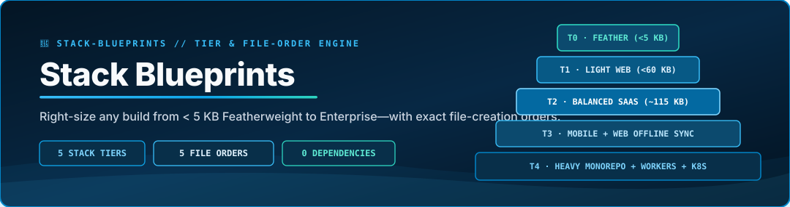

# Stack Blueprints

Come in. Everything here has its place, and nothing is missing.

A 5-tier developer stack matrix — from ultra-light under 5 KB to heavy enterprise — with the exact file-creation order for every build, for builders who want the lightest stack that fits.

## What's here

- `src/stacks.mjs` — the stack matrix.
- `bin/stack-blueprints.mjs` — the zero-dependency CLI.
- `skills/stack-selector/SKILL.md` — the AI agent skill.
- `design-spec/STACK_MATRIX_SPEC.md` — the spec.
- `preview/index.html` — the live stack recommender.

## Use it

`node bin/stack-blueprints.mjs list`

Details live in `docs/START_HERE.md`. License: see `LICENSE`.
