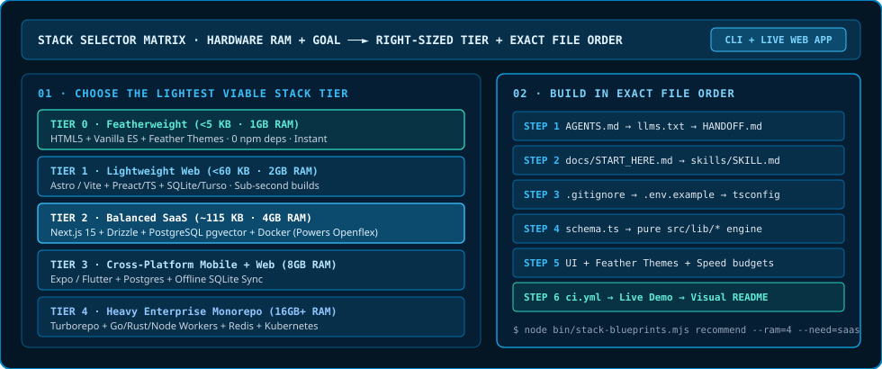

<p align="center">
  <a href="https://kelli-dotcom.github.io/stack-blueprints/preview/">
    
  </a>
</p>

<p align="center">
  <strong>Developer stack matrix (from ultra-light &lt;5 KB to heavy enterprise) + exact workflow file-creation orders for every build specification.</strong><br />
  <em>Pick the lightest, fastest stack that actually fits your hardware, team size, and product goals — zero over-engineering.</em>
</p>

<p align="center">
  <a href="https://kelli-dotcom.github.io/stack-blueprints/preview/"><strong>🚀 Live Stack Recommender</strong></a> ·
  <a href="#-the-5-tier-stack-matrix-lightest--heavy"><strong>Stack Matrix</strong></a> ·
  <a href="#-workflow-file-orders-by-need"><strong>File Orders</strong></a> ·
  <a href="#-quick-start-pc--laptop--mobile"><strong>Quick Start</strong></a> ·
  <a href="skills/stack-selector/SKILL.md"><strong>AI Skill</strong></a> ·
  <a href="https://github.com/kelli-dotcom/stack-blueprints/issues"><strong>Request Stack</strong></a>
</p>

<p align="center">
  <a href="https://kelli-dotcom.github.io/stack-blueprints/preview/"></a>
  <a href="#-the-5-tier-stack-matrix-lightest--heavy"></a>
  <a href="#-workflow-file-orders-by-need"></a>
  <a href="#-quick-start-pc--laptop--mobile"></a>
  <a href="LICENSE"></a>
  <a href="https://github.com/kelli-dotcom"></a>
</p>

---

## 🧭 Live Interactive Stack Recommender

> 👉 **[Launch the Live 5-Tier Stack Recommender & File-Order Explorer →](https://kelli-dotcom.github.io/stack-blueprints/preview/)**  
> Select your device RAM and what you are building — instantly recommends the lightest viable stack (`Tier 0` to `Tier 4`) and gives you a 1-click copyable file-creation order.

<p align="center">
  <a href="https://kelli-dotcom.github.io/stack-blueprints/preview/">
    
  </a>
</p>

---

## ✨ Stop Over-Engineering Small Apps (and Under-Building Big Ones)

Developers routinely reach for heavy enterprise monorepos for a weekend tool—or try to cram a multi-team SaaS into a fragile script. **Stack Blueprints** gives solo founders, teams, and AI coding agents a clear, hardware-aware ladder from **Tier 0 (`<5 KB`, 0 deps)** up to **Tier 4 (Enterprise Monorepo + Kubernetes)**, paired with exact **file-creation & workflow orders** for every scenario.

- **Built For:** Solo founders, full-stack engineers, educators, and AI coding agents starting new projects under real RAM, speed, and budget constraints.
- **When to Reach for It:** In the first 5 minutes of every new repository—before running `npm init` or writing a single line of code.
- **Runs Everywhere:** Zero-dependency Node/Bun CLI (`bin/stack-blueprints.mjs`) + drop-in AI agent skill (`skills/stack-selector/SKILL.md`).
- **Configured with All 6 CRTA Pillars:**
  1. **[`stack-blueprints`](https://github.com/kelli-dotcom/stack-blueprints):** Self-configured on **Tier 0 (`<5 KB`, 0 deps)** following the exact `kickoff` & `launch` file-creation orders.
  2. **[`feather-speed`](https://github.com/kelli-dotcom/feather-speed):** Hardware-aware RAM, CPU & network budgets (`ECO` / `BALANCED` / `ULTRA`) baked into every stack tier.
  3. **[`feather-themes`](https://github.com/kelli-dotcom/feather-themes):** 1,092 zero-dependency photobiology WCAG 2.1 AA/AAA CSS & JSON tokens wired into the stack defaults and `preview/index.html`.
  4. **[`agent-etiquette`](https://github.com/kelli-dotcom/agent-etiquette):** Enforces the 3-agent concurrency cap, Rule-of-2 loop breaker, and `verified_artifacts` contract in [`AGENTS.md`](AGENTS.md).
  5. **[`archetype-agent-vault`](https://github.com/kelli-dotcom/archetype-agent-vault):** Governed by `The Boss` (`waste-management`), `Laid-Back Simplifier`, and `Zero-Mercy Gatekeeper`.
  6. **[`github-trending-kit`](https://github.com/kelli-dotcom/github-trending-kit):** Ships with `launch-director` Developer SDK README archetype, `demo/preview.svg`, and interactive `preview/index.html`.

---

## ⚡ The 5-Tier Stack Matrix (Lightest → Heavy)

| Tier | Name | Target Weight | Min RAM | Speed | Stack | Best Used For |
| :---: | :--- | :---: | :---: | :---: | :--- | :--- |
| **0** | **Featherweight** | `< 5 KB` (0 deps) | `1 GB` | Instant | HTML5 + Vanilla ES + `feather-themes` + `feather-speed` | Micro-tools, theme kits, Chromebooks, offline utilities |
| **1** | **Lightweight** | `< 60 KB` JS | `2 GB` | Sub-sec | Astro / Vite + Preact/TS + Tailwind + SQLite/Turso | Fast directories, docs, solo MVPs on a \$5 VPS |
| **2** | **Balanced SaaS** | `~115 KB` JS | `4 GB` | Fast | Next.js 15 + TS + Drizzle + Postgres `pgvector` + Docker | Live web apps & AI tools (e.g., **Openflex** *(CRTA Proprietary Platform)*) |
| **3** | **Cross-Platform** | Native + Web | `8 GB` | Moderate | Expo (RN) / Flutter + Supabase/Postgres + offline SQLite | Field ops, school kitchens, NFC/camera mobile apps |
| **4** | **Heavy Enterprise** | Monorepo | `16 GB+` | CI-cached | Turborepo + Go/Rust/Node workers + Redis + K8s + OTel | Multi-team platforms, millions of reqs/day, SOC2/HIPAA |

---

## 📋 Workflow File Orders by Need

Run `node bin/stack-blueprints.mjs order <name>` to print the exact step-by-step file creation order:

| Workflow Key | Use When | Order Summary |
| :--- | :--- | :--- |
| **`kickoff`** | Starting any clean-room repo | `AGENTS.md & Specs` → `Config` → `Schema` → `Core Logic` → `UI` → `CI` → `Demo GIF & README` |
| **`mvp`** | 24–48h solo validation | Pick Tier 0/1 → 1-page 5W+H spec → 1 core flow + fallback → Feather Themes → live check |
| **`multi-agent`** | 2–3 AI agents in parallel | Lock `AGENTS.md` (3-agent cap, Rule of 2) → Handoff JSON → Data → Gatekeeper QA → Launch UI |
| **`eco`** | 2–4 GB RAM / \$5 VPS | `feather-perf diagnose` → Tier 0/1 → RAM-capped workers → 32 KB stream cap → pure-CSS FX |
| **`launch`** | Flipping Private → Public | IP Safety Audit → real `demo.gif` → Top-GitHub README → Green CI + SEO → Tue–Thu launch |

---

## 🚀 Quick Start (PC / Laptop & Mobile)

### 💻 1. PC / Laptop Quick Start (Mac, Windows, Linux & Chromebook)

```bash
# 1. Clone Stack Blueprints (0 npm dependencies)
git clone https://github.com/kelli-dotcom/stack-blueprints.git && cd stack-blueprints

# 2. List all 5 tiers from Lightest (<5 KB) to Heavy Enterprise
node bin/stack-blueprints.mjs list

# 3. Get an instant stack recommendation for your RAM & project need
node bin/stack-blueprints.mjs recommend --ram=2 --need=mvp
node bin/stack-blueprints.mjs recommend --ram=8 --need=mobile

# 4. Print the exact workflow file-creation order for your current stage
node bin/stack-blueprints.mjs order kickoff
node bin/stack-blueprints.mjs order multi-agent
```

Or add the 1-line `AGENTS.md` progressive disclosure pointer to any project:
```markdown
- **Stack & File-Order Selection:** Follow `skills/stack-selector/SKILL.md` (`https://github.com/kelli-dotcom/stack-blueprints`) to pick the lowest qualifying stack tier and exact workflow file-creation order.
```

### 📱 2. Mobile Quick Start (iPhone, iPad & Android)

<details>
<summary><strong>📱 Download &amp; Use on Mobile (iOS / Android)</strong></summary>

<br />

1. **1-Tap Direct Download:**  
   👉 **[Download ZIP (Mobile-Friendly)](https://github.com/kelli-dotcom/stack-blueprints/archive/refs/heads/main.zip)**

2. **Quick Unzip Steps:**
   - **iPhone / iPad (iOS):** Open **Files** → **Downloads** → tap `stack-blueprints-main.zip` once to unzip.
   - **Android:** Open **Files by Google** (or **My Files**) → **Downloads** → tap `stack-blueprints-main.zip` → tap **Extract**.
   - **Mobile Browser Tip:** Tap the browser menu (`AA` or `⋮`) → **Request Desktop Website** to reveal GitHub's green **Code → Download ZIP** button anytime.

3. **Explore & Use Immediately on Mobile:**
   - **Interactive 5-Tier Explorer on Your Phone:** Tap `preview/index.html` inside the unzipped folder to interactively browse all 5 stack tiers and 4 workflow file-creation orders in your mobile browser.
   - **Attach in Gemini / Claude / ChatGPT Mobile Apps:** Attach `skills/stack-selector/SKILL.md` and `design-spec/STACK_MATRIX_SPEC.md` in your mobile AI app (or upload once to a **Gemini Gem / Claude Project**) to plan new software architectures from your phone.

</details>

---

## 🤝 Contributing

We welcome new stack tier benchmarks, specialized workflow file-creation orders, and interactive explorer improvements from both **human engineers** and **AI coding agents**:

```bash
# 1. Fork & create a feature branch
git checkout -b feat/your-stack-or-order

# 2. Verify CLI recommendations & file orders (0 npm dependencies)
node bin/stack-blueprints.mjs list && node bin/stack-blueprints.mjs recommend --ram=2 --need=mvp && node bin/stack-blueprints.mjs order kickoff
```

Read the full guide in **[`CONTRIBUTING.md`](CONTRIBUTING.md)** · **[Open an Issue](https://github.com/kelli-dotcom/stack-blueprints/issues)** · **[Submit a Pull Request](https://github.com/kelli-dotcom/stack-blueprints/pulls)**

---

## 🌐 CRTA Tech Solutions Open-Source Ecosystem

| Repository | What It Does |
| :--- | :--- |
| **Openflex** *(CRTA Proprietary Platform)* | Zero-cost, anti-ghost, Remote-Truth job board (Tier 2 reference app) |
| **[stack-blueprints](https://github.com/kelli-dotcom/stack-blueprints)** | 5-tier dev stack matrix & workflow file orders *(this repo)* |
| **[feather-speed](https://github.com/kelli-dotcom/feather-speed)** | Hardware-aware adaptive frontend & backend speed engine (`ECO` / `BALANCED` / `ULTRA`) |
| **[feather-themes](https://github.com/kelli-dotcom/feather-themes)** | 1,092 photobiology-calibrated, 0-dep WCAG AA/AAA themes |
| **[agent-etiquette](https://github.com/kelli-dotcom/agent-etiquette)** | Multi-agent workflow rules, JSON handoff schemas & Rule of 2 loop caps |
| **[archetype-agent-vault](https://github.com/kelli-dotcom/archetype-agent-vault)** | 7 character-driven AI coding agent suites (27 specialists) |
| **[github-trending-kit](https://github.com/kelli-dotcom/github-trending-kit)** | AI agent & skill kit for top-GitHub READMEs, SEO topics & launch copy |

✨ *Crafted by **CRTA Tech Solutions*** • MIT License • GitHub Topic: `crta-crafted`


---

### ⚡ Upgrade to the CRTA Pro Vault (`crta-tech-solutions/crta-pro-vault`)
Want the complete, copy-paste-ready production system in one private repo + 1-tap mobile ZIP? Includes **Production `AGENTS.md` & Handoff Suite**, **High-Conversion Repo & Launch Kit**, and **3-Agent Specialist Squads + Master Context Blueprints**.

- **Solo Pro Pack ($49 one-time):** [Get Instant Access →](https://polar.sh/kelli-dotcom/products/solo-pro-pack)
- **Team Self-Serve License ($299/year):** [Get Team License →](https://polar.sh/kelli-dotcom/products/team-license)

> *Self-serve digital files delivered instantly; no 1-on-1 support or custom calls included.*

---
